> "Saya Rama Taufik Azkia dengan NIM 2508497 mengerjakan Tugas Praktikum 3 dalam mata kuliah Desain dan Pemrograman Berorientasi Objek untuk keberkahanNya maka saya tidak melakukan kecurangan seperti yang telah dispesifikasikan. Aamiin."

*— Janji*

# GARIS BESAR
Aplikasi ini merupakan aplikasi pengelolaan data personil kombatan di suatu organisasi keamanan. Setiap personil memiliki kategori role masing-masing serta level yang menandakan tingkatan kemahiran mereka.

Terdapat 1 kelas, yaitu `person`, dengan atribut berikut: 

  1. `ID`, kode unik khusus yang menjadi pembeda utama antar personil;
  2. Nama (`name`), untuk nama personil;
  3. Tahun lahir (`birth_y`), untuk tahun lahir personil;
  4. Kategori (`category`), untuk kategori personil, didasarkan pada kemampuan kombat masing-masing. Ada 7: *Saber* (ahli bela diri), *Archer* (ahli panah), *Lancer* (ahli tombak), *Rider* (ahli tunggangan), *Caster* (ahli sihir), *Assassin* (ahli pembunuh), dan *Berserker* (*catch-all* untuk personil dengan kemampuan di luar kendali);
  5. `Level`, merujuk pada tingkat kemahiran tiap personil, mulai dari yang terrendah (level 1) hingga yang tertinggi (level 100).

# DESIGN / FUNGSI
Aplikasi ini dibuat dengan memanfaatkan Java Swing, semacam *tool* yang memfasilitasi pembuatan GUI serupa Windows *desktop app*, ditulis dalam bahasa Java. Fungsi yang disediakan, yaitu:

  1. CRUD standar;
  2. *Error handling* berikut:
    | Kondisi | *screenshot* |
    | --- | --- |
    | Mengosongkan data wajib (`ID`, `name`) | 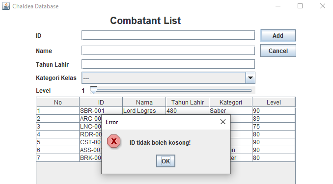 |
    | Memasukkan angka negatif pada input angka | 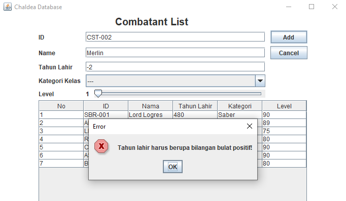 |
    | Memasukkan angka desimal pada input angka | 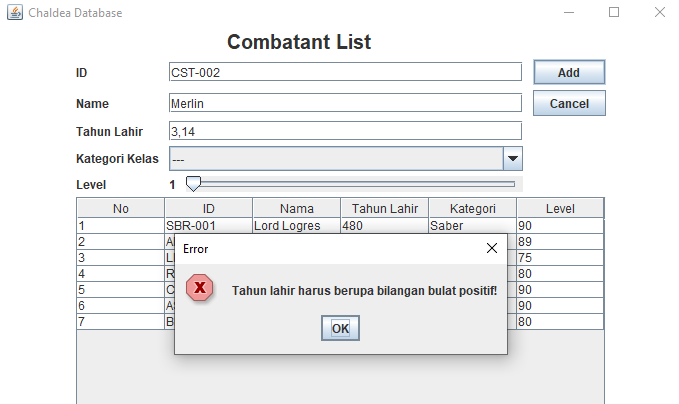 |
    | Memasukkan bukan angka pada input angka | 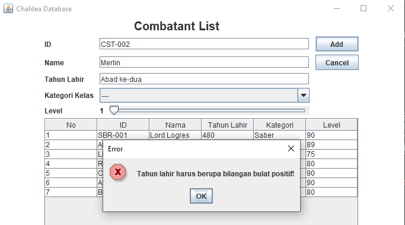 |

# ALUR
Saat pertama kali membuka aplikasi, pengguna akan disambut menu seperti berikut:

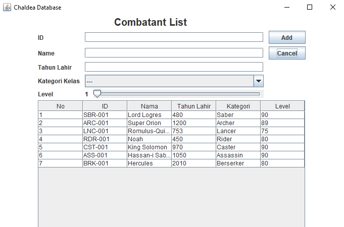

Pada awalnya, tersedia 7 data *dummy*, satu untuk masing-masing kategori. Bagian input data dibuat fleksibel, dapat digunakan dalam fungsi tambah dan ubah data. Untuk melalukan perubahan data sendiri, pertama klik baris data yang ingin di ubah, lalu ubah data pada bagian input. Di saat yang bersamaan, akan juga muncul tombol *delete* yang jelas berfungsi untuk menghapus barid data yang sedang dipilih.

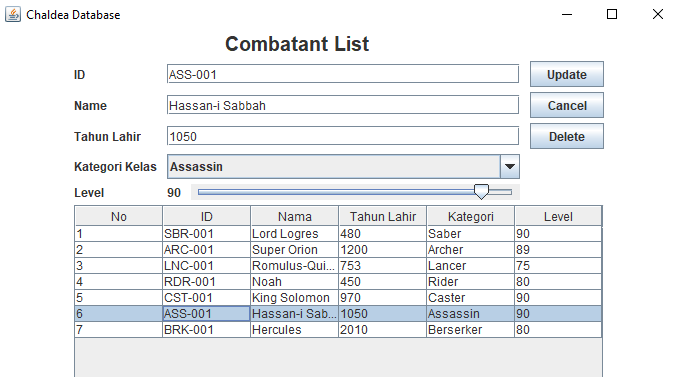

Terakhir, ada tombol *cancel*. Tombol ini akan mengosongkan bagian input, juga membatalkan operasi perubahan data.

# DOKUMENTASI
1. Tambah data

| Keadaan | *screenshot* |
| --- | --- |
| Sebelum tambah data | 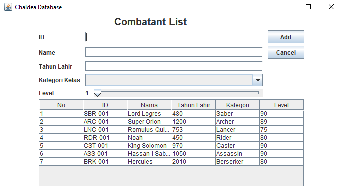 |
| Menambah data | 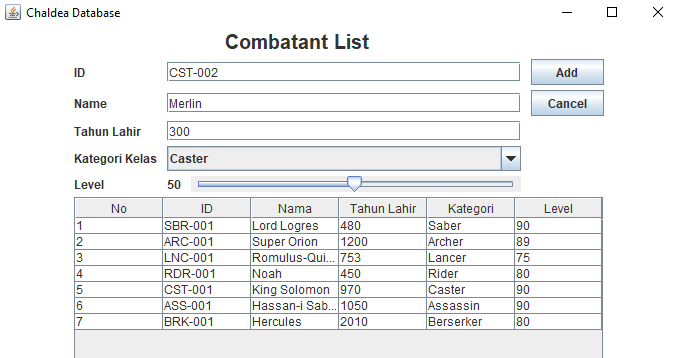 |
| Sesudah tambah data |  |
2. Ubah data

| Keadaan | *screenshot* |
| --- | --- |
| Sebelum ubah data | 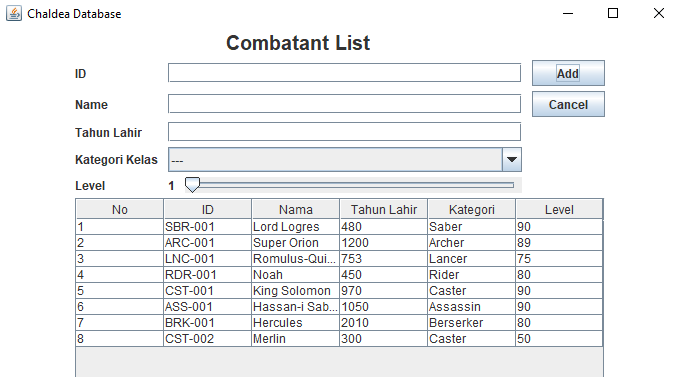 |
| Mengubah data | 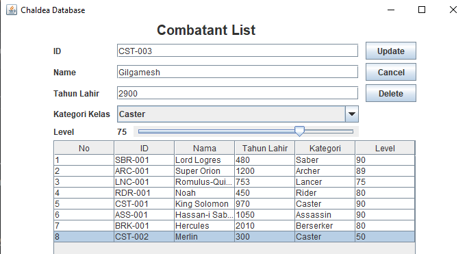 |
| Sesudah ubah data | 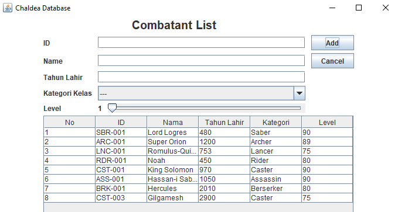 |
3. Hapus data

| Keadaan | *screenshot* |
| --- | --- |
| Sebelum hapus data |  |
| Menghapus data | 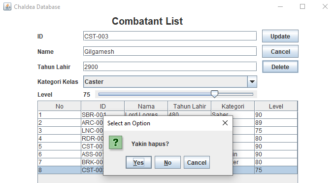 |
| Sesudah hapus data | 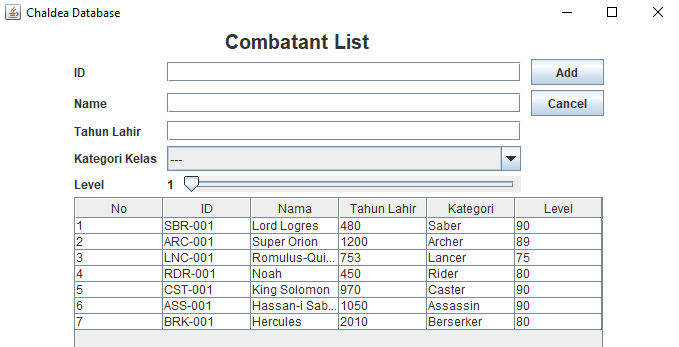 |

# CATATAN
*All credits go to Kinoko Nasu, Type-moon, and the colorful book of human history & mythologies for all references made.*

